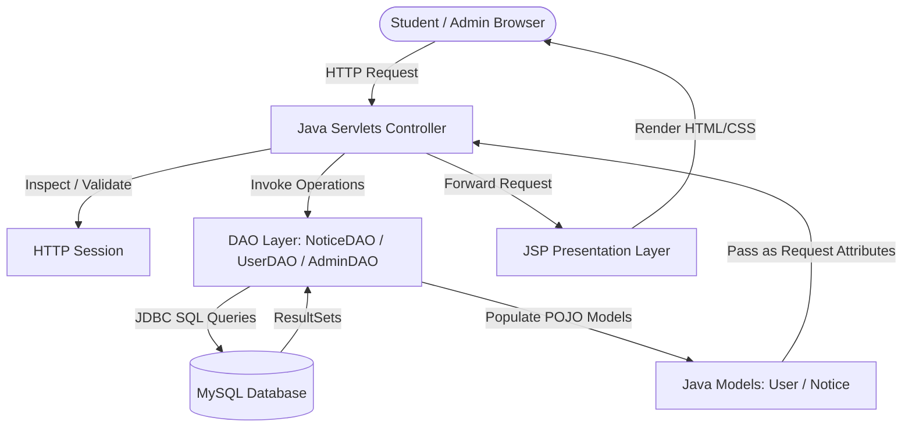
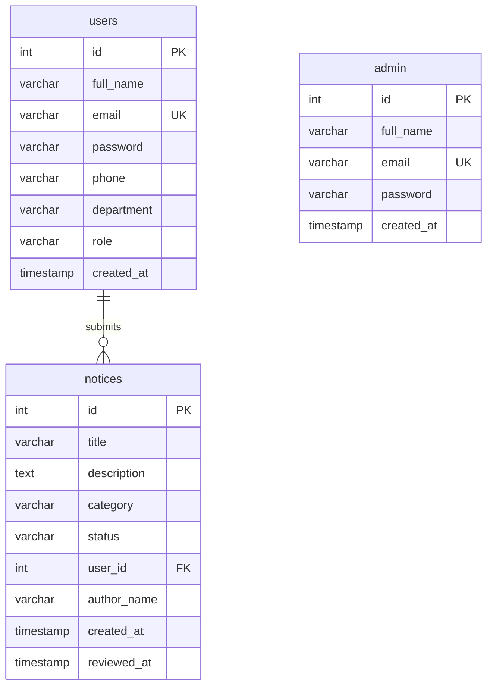

<div align="center">

# 📋 Digital Campus Notice Board
### *College Notice Board Management System*

A full-featured, secure, and modern Java Enterprise web application designed to digitize campus communications, eliminate paper waste, and provide real-time verified announcements for students and faculty.

[](https://www.oracle.com/java/)
[](https://jakarta.ee/)
[](https://tomcat.apache.org/)
[](https://www.mysql.com/)
[](https://netbeans.apache.org/)
[](LICENSE)

<br/>

[Key Features](#-key-features) •
[Tech Stack](#-technology-stack) •
[System Architecture](#-system-architecture) •
[Database Setup](#-database-setup) •
[Installation Guide](#-quick-start--installation) •
[Default Credentials](#-default-credentials) •
[Project Structure](#-project-directory-structure) •
[Authors](#-authors--credits)

---

</div>

## 📖 Overview

The **Digital Campus Notice Board** replaces traditional physical notice boards with an efficient, categorized, and centralized online platform. Students can submit articles, announcements, and event circulars, which undergo a strict administrative review workflow before going live.

This ensures that only verified, high-quality, and relevant notices reach the student body while keeping records organized and searchable.

---

## ✨ Key Features

### 🎓 Student Portal
- **Secure Authentication**: Registration and login with session validation.
- **Notice Submission**: Easily publish notices across three categories:
  - 📅 **Events**: Hackathons, cultural fests, workshops, sports meets.
  - 📢 **Announcements**: Exam timetables, fee circulars, official notifications.
  - 📝 **Articles**: Technical write-ups, student opinions, research summaries.
- **Track Submissions**: Real-time status indicators (`Pending`, `Approved`, `Rejected`).
- **Profile Management**: Update full name, phone number, department, and password.
- **Interactive Digital Notice Board**: Browse and filter verified college notices.

### 🛡️ Admin Portal
- **Administrative Control**: Dedicated, restricted admin login endpoint.
- **Analytics Dashboard**: Instant metric tiles showing:
  - Total Notice Submissions
  - Pending Approvals Counter
  - Approved & Live Notices
  - Rejected Submissions
  - Total Registered Students
- **Notice Moderation**: One-click actions to **Approve**, **Reject**, or **Delete** notices.
- **Student User Management**: View directory of registered students and manage accounts.

### 🎨 Design & Aesthetics
- Styled with bespoke Vanilla CSS, Google Fonts (*Playfair Display* & *DM Sans*), and responsive layouts.
- Zero external CSS bloat; lightning-fast page loading and crisp rendering across desktops, tablets, and smartphones.

---

## 🛠️ Technology Stack

| Layer | Technology | Description |
| :--- | :--- | :--- |
| **Presentation (View)** | JSP (JavaServer Pages 2.3+), HTML5, CSS3, JS | Dynamic rendering with reusable layout components |
| **Controller** | Java Servlets (JSP/Servlet 4.0 API) | Handles HTTP GET/POST, sessions, and request routing |
| **Business & Data Access** | Java (JDK 17/21), DAO Pattern, Java Beans | Encapsulated business logic and data mapping |
| **Database** | MySQL 8.x / MariaDB | Relational schema with Foreign Keys and Cascading Deletes |
| **Database Driver** | MySQL Connector/J (`mysql-connector-j-9.6.0.jar`) | Type-4 JDBC driver bundled in `WEB-INF/lib` |
| **Application Server** | Apache Tomcat 9.0+ / 10.x | Servlet container for web module deployment |
| **Development IDE** | Apache NetBeans 19+ / Eclipse / IntelliJ IDEA | Native Ant-based web application structure |

---

## 🏛️ System Architecture

The project strictly follows the **Model-View-Controller (MVC)** architectural design pattern:



---

## 🗄️ Database Setup

The database schema is automated via `database/schema.sql` (or `database.sql`).

### 1. Schema Tables Overview



### 2. Import Database via MySQL CLI or phpMyAdmin

**Option A — Using MySQL Terminal:**
```bash
mysql -u root -p < database/schema.sql
```

**Option B — Using phpMyAdmin / MySQL Workbench:**
1. Open phpMyAdmin (`http://localhost/phpmyadmin`).
2. Create a database named `college_notice_board` (or let the script create it).
3. Click the **Import** tab.
4. Select `database/schema.sql` and click **Go**.

---

## 🚀 Quick Start & Installation

### Prerequisites
- **JDK (Java Development Kit)**: Version 11, 17, or 21 installed and added to `PATH`.
- **Apache Tomcat**: Version 9.0.x (recommended) or 10.x.
- **MySQL Server**: Running on port `3306` (XAMPP / WampServer / Standalone MySQL).
- **Apache NetBeans IDE** (Recommended for 1-click run) or Eclipse / IntelliJ IDEA.

### Step 1: Clone the Repository
```bash
git clone https://github.com/aibinjmca2527-dotcom/Digital-Campus-Notice-Board.git
cd Digital-Campus-Notice-Board
```

### Step 2: Database Configuration
Verify your MySQL connection details in `src/java/src/com/noticeboard/util/DBConnection.java`:
```java
// Default configuration:
private static final String URL = "jdbc:mysql://localhost:3306/college_notice_board";
private static final String USER = "root";
private static final String PASSWORD = ""; // Update if your MySQL has a password
```
*(Optionally, you can set the `DB_URL`, `DB_USER`, and `DB_PASSWORD` environment variables without touching source code!)*

### Step 3: Run in Apache NetBeans (Recommended)
1. Launch **Apache NetBeans**.
2. Click **File** > **Open Project...**
3. Select the `Digital-Campus-Notice-Board` (or `CollegeNoticeBoard`) directory.
4. Right-click the project > **Properties** > **Run** > verify **Server** is set to **Apache Tomcat**.
5. Right-click the project > **Run** (or press `F6`).
6. NetBeans will compile, deploy the application to Tomcat, and launch your browser at:
   `http://localhost:8080/CollegeNoticeBoard/`

---

## 🔑 Default Credentials

The database script pre-seeds standard accounts for immediate testing:

### 🛡️ Administrator Account
| Attribute | Value |
| :--- | :--- |
| **Portal URL** | `http://localhost:8080/CollegeNoticeBoard/admin-login.jsp` |
| **Email** | `admin@college.edu` |
| **Password** | `admin123` |
| **Permissions** | Approve/Reject notices, remove users, view global metrics |

### 🎓 Demo Student Account
| Attribute | Value |
| :--- | :--- |
| **Portal URL** | `http://localhost:8080/CollegeNoticeBoard/login.jsp` |
| **Email** | `aibin@college.edu` |
| **Password** | `student123` |
| **Permissions** | Submit notices, manage profile, view personal notice statuses |

*(You can also click **Register** to create any number of new student accounts dynamically.)*

---

## 📂 Project Directory Structure

```text
Digital-Campus-Notice-Board/
├── .gitignore                      # Git exclusion rules (builds, caches, private properties)
├── LICENSE                         # MIT Open Source License
├── README.md                       # Repository documentation
├── build.xml                       # Ant build script
├── database.sql                    # Root SQL initialization dump
├── database/
│   └── schema.sql                  # Automated schema and seed data script
├── nbproject/                      # NetBeans project configuration
│   ├── ant-deploy.xml
│   ├── build-impl.xml
│   ├── genfiles.properties
│   ├── project.properties          # Classpath and build properties
│   └── project.xml                 # Web module settings
├── src/
│   ├── conf/
│   │   └── MANIFEST.MF
│   └── java/
│       └── src/com/noticeboard/
│           ├── dao/                # Data Access Object layer
│           │   ├── AdminDAO.java   # Admin verification & lookup
│           │   ├── NoticeDAO.java  # Notice CRUD & counter queries
│           │   └── UserDAO.java    # Student registration & auth
│           ├── model/              # Domain models (POJOs)
│           │   ├── Notice.java     # Notice entity definition
│           │   └── User.java       # User entity definition
│           ├── servlet/            # Controller Servlets
│           │   ├── AdminDashboardServlet.java
│           │   ├── AdminLoginServlet.java
│           │   ├── LoginServlet.java
│           │   ├── LogoutServlet.java
│           │   ├── ManageNoticesServlet.java
│           │   ├── ManageUsersServlet.java
│           │   ├── RegisterServlet.java
│           │   ├── SubmitNoticeServlet.java
│           │   ├── UpdateProfileServlet.java
│           │   └── ViewNoticesServlet.java
│           └── util/
│               └── DBConnection.java   # MySQL JDBC connection factory
└── web/                            # Web root directory
    ├── index.html                  # Welcome redirect
    ├── index.jsp                   # Landing page
    ├── login.jsp                   # Student sign-in
    ├── register.jsp                # Student registration
    ├── admin-login.jsp             # Administrator sign-in
    ├── css/
    │   └── style.css               # Complete stylesheet
    ├── admin/
    │   ├── dashboard.jsp           # Admin metrics & pending table
    │   ├── manage-notices.jsp      # Notice moderation hub
    │   └── manage-users.jsp        # Student user directory
    ├── student/
    │   ├── dashboard.jsp           # Student summary & quick links
    │   ├── my-notices.jsp          # Student's submitted notices
    │   ├── notice-board.jsp        # Public filtered notice board
    │   ├── profile.jsp             # Profile view & update form
    │   └── submit-notice.jsp       # Notice creation form
    ├── META-INF/
    │   └── context.xml             # Tomcat web application context
    └── WEB-INF/
        ├── web.xml                 # Servlet routing & deployment descriptor
        └── lib/
            └── mysql-connector-j-9.6.0.jar  # Bundled MySQL JDBC driver
```

---

## 🗺️ Servlet Routing Reference

| URL Pattern | Servlet Class | Supported Methods | Role | Function |
| :--- | :--- | :--- | :--- | :--- |
| `/register` | `RegisterServlet` | POST | Public | Validates & registers new student account |
| `/login` | `LoginServlet` | POST / GET | Public | Authenticates student & initializes session |
| `/logout` | `LogoutServlet` | GET | Authenticated | Invalidates session & redirects to home |
| `/submitNotice` | `SubmitNoticeServlet` | POST / GET | Student | Creates a notice with `pending` status |
| `/viewNotices` | `ViewNoticesServlet` | GET | Public / Student | Fetches approved notices for the notice board |
| `/updateProfile` | `UpdateProfileServlet` | POST / GET | Student | Modifies profile information or password |
| `/adminLogin` | `AdminLoginServlet` | POST / GET | Public | Authenticates admin credentials |
| `/adminDashboard` | `AdminDashboardServlet` | GET | Admin | Loads analytical counters & recent pending notices |
| `/manageNotices` | `ManageNoticesServlet` | GET / POST | Admin | Filters, approves, rejects, or deletes notices |
| `/manageUsers` | `ManageUsersServlet` | GET / POST | Admin | Lists student accounts & supports deletion |

---

## 🔒 Security Best Practices

- **Parameterized Queries**: All database operations use `PreparedStatement` to defend against SQL Injection (SQLi) attacks.
- **Access Control & Session Guarding**: Admin and student dashboard routes verify active session tokens; unauthorized access attempts are redirected to respective login gates.
- **Exclusion of Secrets**: Machine-specific configuration (`nbproject/private/`) and compiled binaries are excluded from version control via `.gitignore`.
- **Relational Integrity**: Foreign key constraints with `ON DELETE CASCADE` ensure referential integrity when user accounts are removed.

---

## 👨‍💻 Author & Developer

Designed and developed with dedication by:
- **Aibin Joseph** ([@aibinjmca2527-dotcom](https://github.com/aibinjmca2527-dotcom))

---

## 📄 License

This project is licensed under the [MIT License](LICENSE) — free to use for educational and institutional purposes.
